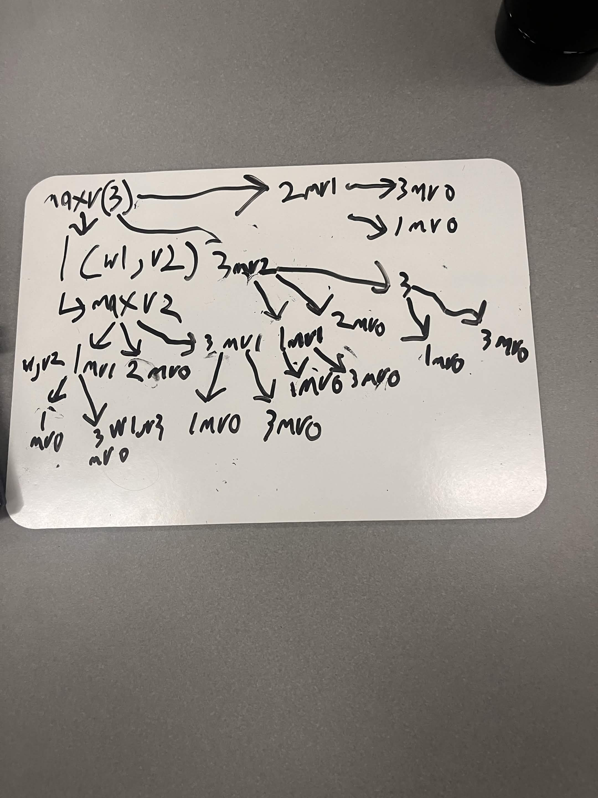

# Lab 07: The Integer-Valued Knapsack Problem

**Name:** _______________________  

## Introduction
In this lab, you will explore different variations of the Knapsack problem and design a dynamic programming solution for one of them. You may work in small groups or individually, but everyone should write up their own answers to the questions below. 

Suppose we're going hiking. We have items $1, \ldots, n$ that we could pack in multiples with corresponding values $v_1, \ldots, v_n$ and weights $w_1, \ldots, w_n$. For example, we might have a water bottle (weight 1, value 2) and a sandwich (weight 2, value 5). Consider the following three problem variations:

1. Maximize value subject to capacity $W$, where you can pack at most one of each item.
2. Maximize value subject to capacity $W$, where you can pack a positive integer value of each item.
3. Minimize weight subject to minimum value $V$, where you can pack a positive integer value of each item.

---

## Part 1: Dynamic Programming Fundamentals

**Question:** Which of the three problem variations can be solved using the dynamic programming approaches we've studied in lecture? Explain your reasoning.

*Your Answer:* All three variations can be solved using dynamic programming, although they require slightly different table definitions.

0/1 Knapsack: Each item can be used at most once. The table can track the best value for each capacity while considering each item.

Integer-valued or unbounded Knapsack: Items can be used multiple times. The table can track the maximum value achievable for every capacity.

Minimum-weight Knapsack: The table can track the minimum weight needed to reach every value from (0) through (V).
Dynamic programming works because each problem has overlapping subproblems and optimal substructure.

## Part 2: The Naive Recursive Algorithm

Below is a naive recursive algorithm intended to solve one of the variations listed above.

```text
Function MaxValue(W):
    if W == 0:
        return 0
        
    max_val = 0
    for i from 1 to n:
        if w_i <= W:
            current_val = v_i + MaxValue(W - w_i)
            if current_val > max_val:
                max_val = current_val
                
    return max_val
```

**Question:** Which of the three problem variations (1, 2, or 3) does this algorithm solve? How do you know? Explain your reasoning.

*Your Answer:* The algorithm solves Variation 2: maximize value with unlimited copies of each item.

The loop considers every item that fits in the remaining capacity. After choosing item (i), it calls:

[
\text{MaxValue}(W-w_i)
]

The same item can be chosen again in later recursive calls. Therefore, there is no restriction preventing multiple copies of an item from being used.

## Part 3: Recursion Tree

Consider the following simple example:
* **Knapsack Capacity:** $W = 3$
* **Item 1:** Weight $w_1 = 1$, Value $v_1 = 2$
* **Item 2:** Weight $w_2 = 2$, Value $v_2 = 5$
* **Item 3:** Weight $w_3 = 1$, Value $v_3 = 3$

**Question:** Draw the full recursion tree for `MaxValue(3)` using the example above. Label the remaining capacity at each node and indicate which item is chosen along each branch.

*Your Answer (take a picture and upload it):*


## Part 4: Recurrence Relation

**Question:** Derive a mathematical recurrence relation for $OPT(W)$, the maximum value you can pack into a knapsack of capacity $W$, based on the naive recursive algorithm. Be sure to state your base case(s) and explain how you arrived at your formula.

*Your Answer: * Let (OPT(W)) be the maximum value that can be packed into a knapsack with capacity (W).

The recurrence is:

[
OPT(W)=
\begin{cases}
0, & W=0 \
\displaystyle\max_{i:w_i\leq W}
\left(v_i+OPT(W-w_i)\right), & W>0
\end{cases}
]

The base case is:

[
OPT(0)=0
]

When the capacity is greater than zero, we try every item that fits. For each item, we add its value to the best value achievable using the remaining capacity. We then choose the largest result.


## Part 5: Bottom-Up Dynamic Programming

Instead of using the slow recursive approach, we can build a table bottom-up. 

**Question:** Use your recurrence relation from Part 4 to fill in the following table for the example provided in Part 3 ($w_1=1, v_1=2$ and $w_2=2, v_2=5$). At each step, record the optimal value and the specific item chosen to achieve that value. 

| Capacity ($W$) | Optimal Value ($OPT$) | Item Chosen |
|:---:|:---|:---|
| **0** | 0 |none |
| **1** |3 |item 3 |
| **2** |6 |item 3 |
| **3** |9 |item 3 |
| **4** |12 |item 3 |
| **5** |15|item 3 |
| **6** |18|item 3 |

*Explain how you calculated the row for $W=6$*

[
\begin{aligned}
\text{Item 1: }&2+OPT(5)=2+15=17\
\text{Item 2: }&5+OPT(4)=5+12=17\
\text{Item 3: }&3+OPT(5)=3+15=18
\end{aligned}
]

Therefore:

[
OPT(6)=18
]

Item 3 is chosen at every capacity because it provides the greatest value per unit of weight:

[
\frac{v_3}{w_3}=\frac{3}{1}=3
]

Thus, for capacity (6), the optimal solution uses six copies of Item 3

## Part 6: Traceback

**Question:** Using the "Item Chosen" column from the table you completed in Part 5, trace back to find the exact quantities of each item to pack that maximize the value. What is the final optimal packing configuration for $W=6$ and the maximum value?

*Your Answer:*
Start at capacity (6):

At (W=6), choose item 2.
Remaining capacity: (6-2=4)
At (W=4), choose item 2.
Remaining capacity: (4-2=2)
At (W=2), choose item 2.
Remaining capacity: (2-2=0)
Item	Quantity
Item 1	0
Item 2	3

The total weight is:

[
3(2)=6
]

The total value is:

[
3(5)=15
]

Therefore, the final answer is:

[
\boxed{\text{Pack 3 copies of Item 2 for a maximum value of }15}
]

